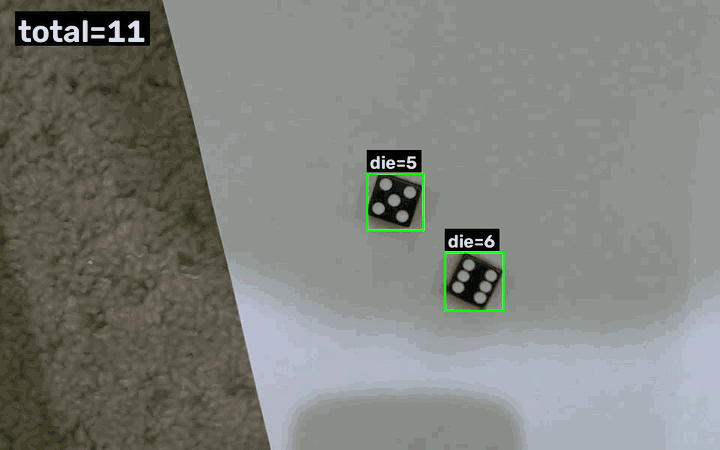

DiceRoller
==========
Reads dice with OpenCV. It finds each die with a median blur, Canny and contours, then counts the dots on just that die with a blob detector and writes the roll and the total on the frame. Made with Michael Li.



### create virtual env
python3 -m venv env

### link virtualenv
source env/bin/activate

# install libs
pip install -r requirements.txt

### run it
```
# webcam
python video_capture.py

# the recording in this repo, no windows, writes the annotated video
python video_capture.py demo1.avi --scrub --headless -o annotated.avi

# pictures of the blue die in the roller, any key goes to the next one
python video_capture.py dice/*.jpg --dice blue
```

`-o` also takes a folder and saves a png per frame, which is how the gif got made (plus ffmpeg). `--debug` shows the edges and each die as it gets counted, `q` quits.

### notes
* `demo1.avi` was recorded with an older version of this that drew its own boxes and counts onto the frames. `--scrub` paints those out first so it doesn't read its own writing.
* `demo.avi` and `output.avi` are empty, the script used to overwrite them every time it ran
* dice that are mid roll or under a finger get skipped
* `dice/im4.jpg` says 2 instead of 3, the dot on the edge of the cup gets cut off
